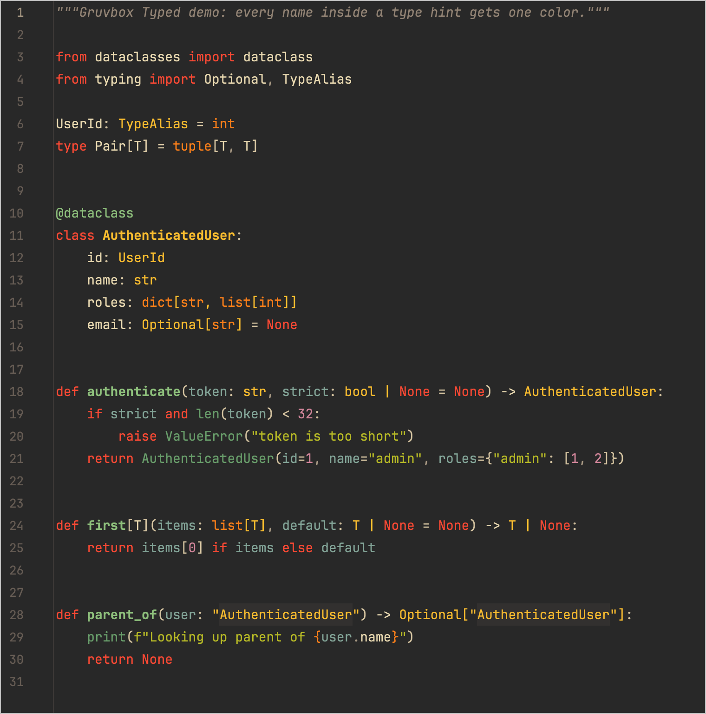
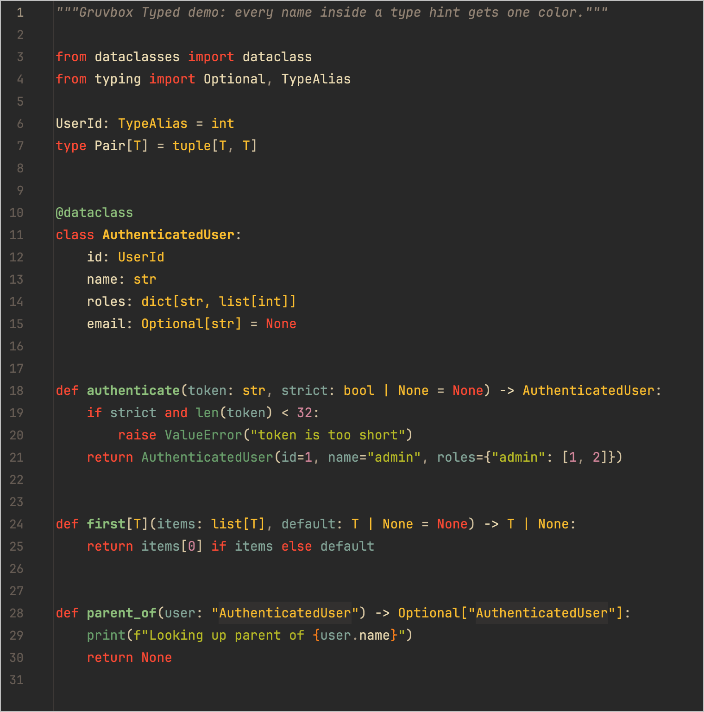

# Gruvbox Typed


[](https://plugins.jetbrains.com/plugin/MARKETPLACE_ID)
[](https://plugins.jetbrains.com/plugin/MARKETPLACE_ID)

<!-- Plugin description -->
**Gruvbox Typed** is a dark [Gruvbox](https://github.com/morhetz/gruvbox) theme for JetBrains IDEs
with one extra trick for Python: every name inside a type hint gets the same color.

Out of the box PyCharm can paint `bool` in `def f(x: bool) -> AuthenticatedUser` as a built-in name
and `AuthenticatedUser` as an annotation, so one signature mixes two colors.
Gruvbox Typed highlights both — and everything else inside type hints — with a single **Type hint** color.

What's included:

- **Gruvbox Typed Dark** UI theme on the Gruvbox Dark Medium palette.
- **Gruvbox Typed Dark Medium** editor color scheme: general code, Python, Kotlin/Java, JavaScript/TypeScript,
  JSON, YAML, Markdown, SQL, console and VCS diffs.
- **Python type hint highlighting** for parameter, return and variable annotations, `Optional[...]`, `X | None`,
  nested generics, string annotations (`"Foo"`), `TypeAlias`, `type X = ...` and PEP 695 generics (`def f[T](x: T) -> T`).
  Available wherever the Python plugin is installed (PyCharm, IntelliJ IDEA with Python, ...).

The color can be changed in <kbd>Settings</kbd> | <kbd>Editor</kbd> | <kbd>Color Scheme</kbd> | <kbd>Python Type Hints</kbd>
and works with any color scheme (it falls back to the scheme's class reference color).

Gruvbox color palette by Pavel Pertsev (morhetz), MIT License.
<!-- Plugin description end -->

## Screenshots

| Before: type hint color off                 | After: Gruvbox Typed                      |
|---------------------------------------------|-------------------------------------------|
|  |  |

Before, `dict`, `list`, `int` and `tuple` inside annotations come out orange while `str`, `bool` and `Optional` are yellow.
After, every name inside a type hint uses one color.

The images are rendered from [`demo/type_hints.py`](demo/type_hints.py) by
`./gradlew test --tests '*ReadmeScreenshotsTest*' -Pscreenshots` with the bundled color scheme.
Test projects have no Python SDK, so the test marks built-in names the way PyCharm does.

## Installation

- Using the IDE built-in plugin system:

  <kbd>Settings/Preferences</kbd> > <kbd>Plugins</kbd> > <kbd>Marketplace</kbd> > <kbd>Search for "Gruvbox Typed"</kbd> >
  <kbd>Install</kbd>

- Using JetBrains Marketplace:

  Go to [JetBrains Marketplace](https://plugins.jetbrains.com/plugin/MARKETPLACE_ID) and install it by clicking the <kbd>Install to ...</kbd> button in case your IDE is running.

- Manually:

  Download the [latest release](https://github.com/Valerii-Synenko/gruvbox-typed-jetbrains/releases/latest) and install it using
  <kbd>Settings/Preferences</kbd> > <kbd>Plugins</kbd> > <kbd>⚙️</kbd> > <kbd>Install plugin from disk...</kbd>

Then select the theme in <kbd>Settings</kbd> | <kbd>Appearance & Behavior</kbd> | <kbd>Appearance</kbd> | <kbd>Theme</kbd> > **Gruvbox Typed Dark**.
The editor color scheme **Gruvbox Typed Dark Medium** is switched on together with the theme and can also be used
with any other UI theme via <kbd>Settings</kbd> | <kbd>Editor</kbd> | <kbd>Color Scheme</kbd>.

## Configuration

| What                                    | Where                                                                                    |
|-----------------------------------------|------------------------------------------------------------------------------------------|
| Type hint color                         | <kbd>Editor</kbd> \| <kbd>Color Scheme</kbd> \| <kbd>Python Type Hints</kbd> \| **Type hint** |
| Turn type hint coloring off             | Same place: uncheck **Inherit values from** and leave **Foreground** empty                |
| Built-in names outside type hints       | <kbd>Editor</kbd> \| <kbd>Color Scheme</kbd> \| <kbd>Python</kbd> \| **Built-in name**    |

What counts as a type hint:

```python
def f(x: bool | None, ids: list[int]) -> "AuthenticatedUser": ...   # parameters, return, string annotations
count: dict[str, list[int]] = {}                                      # variable annotations
UserId: TypeAlias = int                                               # explicit type aliases
type Pair[T] = tuple[T, T]                                            # PEP 695 aliases
def first[T: Hashable](items: list[T]) -> T: ...                      # PEP 695 type parameters
x = []  # type: list[int]                                             # type comments
```

Values that merely appear inside annotations, such as the `Field(gt=0)` call in `Annotated[int, Field(gt=0)]`, keep their usual colors.
Errors and warnings (unresolved references, unused imports) are still drawn on top of the type hint color.

## How it works

Inside an annotation PyCharm puts two highlighters on a built-in name like `bool`: `PY.ANNOTATION` and
`PY.BUILTIN_NAME`. Both cover the same range on the same highlighting layer, so the visible color depends on
the order of the highlighters. That is why built-ins inside type hints change color unpredictably.

Gruvbox Typed registers a Python annotator that marks names inside type hints with the `PY_TYPE_HINT`
text attributes key and `HighlightSeverity.TEXT_ATTRIBUTES`. That severity puts the highlighter one layer above
syntax highlighting and below warnings and errors, so the type hint color always wins and unresolved or unused
references still show. The annotator only looks at syntax and never resolves references, so it is cheap and
also runs while the IDE is indexing.

## Development

```shell
./gradlew test       # annotator, priority and resource tests
./gradlew runIde     # PyCharm with the plugin and the demo/ file
./gradlew buildPlugin
```

Requires JDK 21. The plugin is built against PyCharm 2026.3 and supports IDE builds 252 (2025.2) and newer.

### Releasing

1. First release: run `./gradlew buildPlugin` and upload `build/distributions/gruvbox-typed-jetbrains-<version>.zip`
   manually at [plugins.jetbrains.com](https://plugins.jetbrains.com/plugin/add). Then replace `MARKETPLACE_ID` in the badges above.
2. Next releases: create a [Marketplace token](https://plugins.jetbrains.com/author/me/tokens) and store it as the
   `PUBLISH_TOKEN` repository secret. Optionally add `CERTIFICATE_CHAIN`, `PRIVATE_KEY` and `PRIVATE_KEY_PASSWORD`
   for [plugin signing](https://plugins.jetbrains.com/docs/intellij/plugin-signing.html).
3. Bump `pluginVersion` in `gradle.properties` and describe the changes under `[Unreleased]` in `CHANGELOG.md`.
   Every push to `main` builds the plugin and creates a draft GitHub release. Publishing that draft runs the
   Release workflow, which calls `./gradlew publishPlugin` and opens a PR with the updated changelog.

## Credits

- Gruvbox palette: [morhetz/gruvbox](https://github.com/morhetz/gruvbox) by Pavel Pertsev, MIT License.
- Inspired by [jdinhify/vscode-theme-gruvbox](https://github.com/jdinhify/vscode-theme-gruvbox).

## License

[MIT](LICENSE)

---
Plugin based on the [IntelliJ Platform Plugin Template][template].

[template]: https://github.com/JetBrains/intellij-platform-plugin-template
